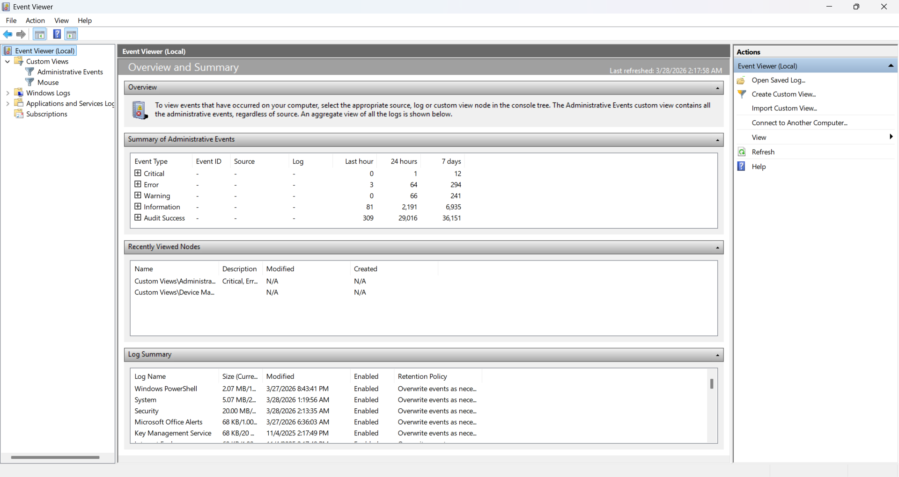
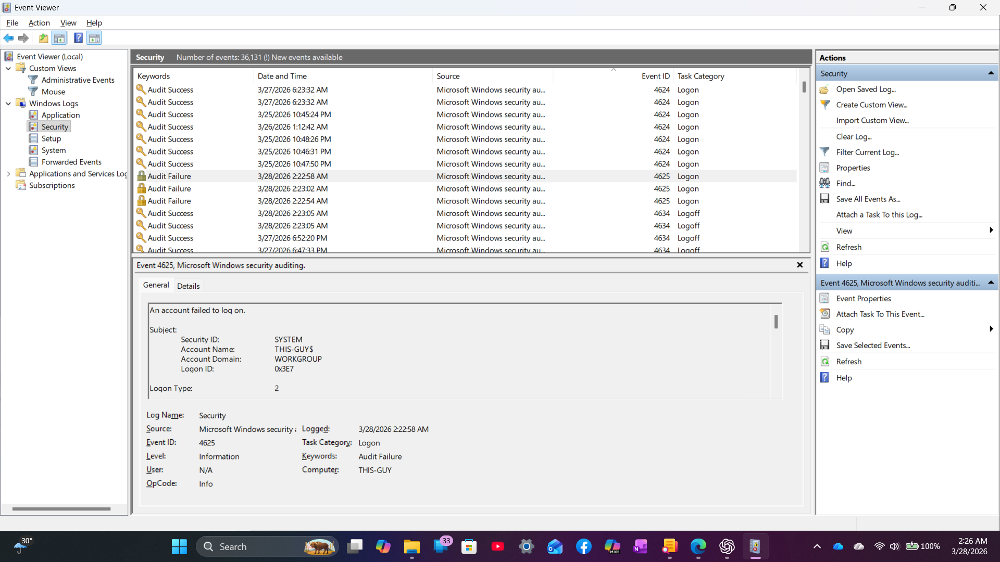
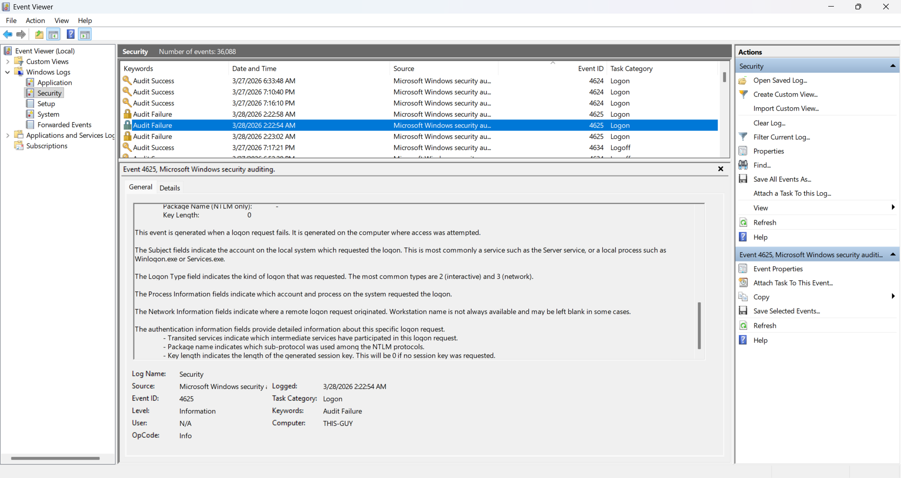

# Windows Failed Logon Analysis

Used Event Viewer on Windows 11 to find and interpret failed logons.

## Steps
1. Opened **Windows Logs > Security**.
2. Filtered authentication events.
3. Found **Event ID 4625** (failed logon).
4. Reviewed timestamp, account, logon type, source, and failure reason.
5. Checked nearby events for repeated failures.

## Findings
- Audit Failure, Event ID 4625, **Logon Type 2** (local interactive)
- No confirmed malicious activity

One failed logon isn't proof of an attack; frequency, source, accounts, and timing matter.

## Screenshots

[← Back to all projects](../)
