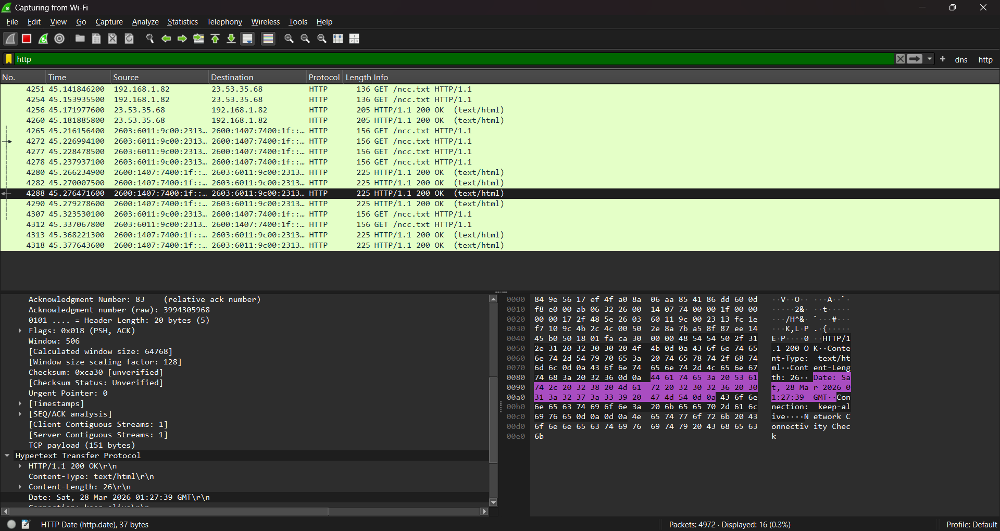
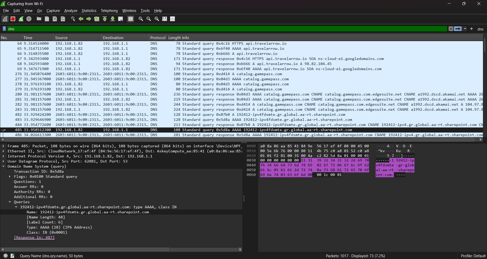
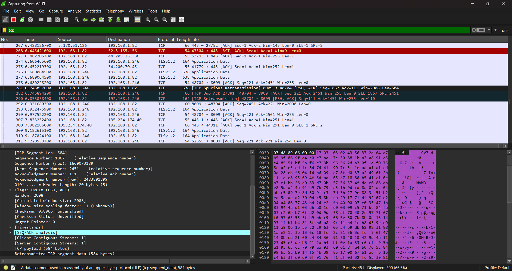

# Wireshark Traffic Analysis

Captured browser traffic on Windows and analyzed HTTP, DNS, and TCP.

## Steps
1. Live capture on the active interface
2. Generated web and DNS traffic
3. Filtered by `http`, `dns`, `tcp`
4. Inspected packets and followed TCP streams

## Observations
**HTTP:** requests are readable in plain text, so unencrypted data can be intercepted.

**DNS:** hostname queries and responses, useful for troubleshooting and investigations.

**TCP:** SYN, SYN-ACK, ACK three-way handshake.

No malicious activity found; the lab shows the analysis process on normal traffic.

[← Back to all projects](../)
